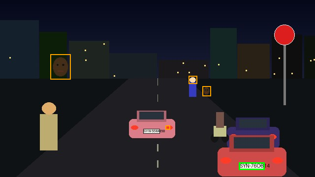
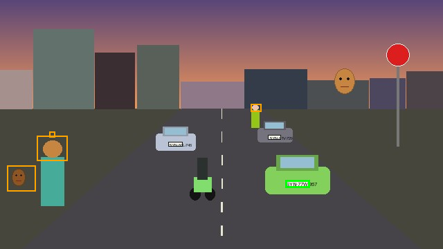
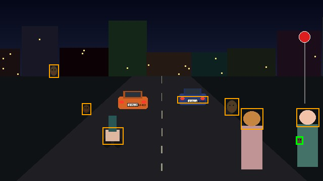

# T07 internal failure evidence

Green = CVAT reference; orange = predicted redaction. Labels are incomplete/unverified.

Root-cause hypotheses below are not confirmed by intermediate detector traces.

## Plate detection case: pii_01, cvat:8

- Split: eval; type: plate; CVAT bbox: [485.81, 330.96, 51.62, 14.32].
- Coverage=0.00000000; threshold=0.9; predicted boxes on image=4.
- Observed: predicted redactions do not cover the labeled plate sufficiently.
- Hypothesis: edge/shape heuristics or candidate filters fail for this region; exact rejecting stage is not traced.
- Next step: inspect intermediate detections and analogous dev cases; do not tune on eval.

## Plate detection case: pii_04, cvat:19

- Split: eval; type: plate; CVAT bbox: [412.01, 260.79, 35.77, 10.71].
- Coverage=0.00000000; threshold=0.9; predicted boxes on image=4.
- Observed: predicted redactions do not cover the labeled plate sufficiently.
- Hypothesis: edge/shape heuristics or candidate filters fail for this region; exact rejecting stage is not traced.
- Next step: inspect intermediate detections and analogous dev cases; do not tune on eval.

## Suspected label-quality issue: pii_03, cvat:14

- Split: eval; type: face; CVAT bbox: [586.84, 271.91, 13.4, 15.5].
- Coverage=0.00000000; threshold=0.9; predicted boxes on image=7.
- Visual inspection places the reference face box on clothing. Verify the annotation; do not claim a real face was missed.
- This annotation is NOT silently removed or corrected in metric calculation.

